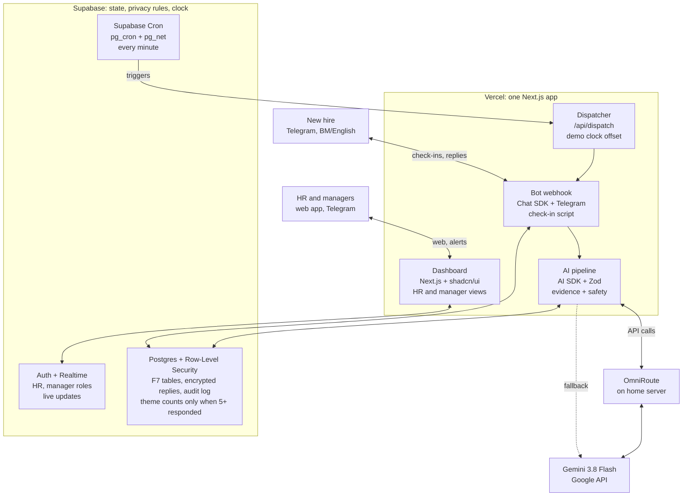

# AIFM Problem 04 — Prototype Architecture

*As of 14 Oct 2026 · Live version: [Claude Doc](https://claude.ai/code/artifact/e40dee12-b432-4053-a659-68b1cc87acda)*

Sapa runs as one Next.js app on Vercel, one Supabase project, and one chat bot built on Vercel's Chat SDK, with every AI call going to Gemini 3.8 Flash through the OmniRoute gateway. Almost everything is assembled from existing frameworks; the custom code is the product itself: the check-in script, the theme taxonomy, the prompts and the privacy rules from the [Sapa dossier](03-research-dossier.md).

## 1. What the prototype must prove

The prototype must run one complete loop live in under two minutes: a new hire answers a check-in on their phone, AI turns it into tagged themes, HR reviews and approves a drafted action, and the manager closes it.

The AIFM guide sets the hard constraints:

- **Minimum output:** employee feedback → AI finds themes → HR or manager reviews → support action.
- **Rule:** transparent, voluntary information only. No secret monitoring, no emotion inference.
- **Data:** fictional, anonymised or permitted sample data only, never real employee records in public AI tools.
- **Pitch:** 8–10 minutes including Q&A, of which the demo gets 1–2 minutes, and at most 10 slides.
- **Judging:** AI solution, innovation and pitch-plus-live-demo are worth 20% each, so demo reliability is an architecture requirement, not a polish item.

| Area | In the prototype | Pitch only |
| --- | --- | --- |
| Employee channel | Telegram check-in bot, BM and English, text and button replies | WhatsApp (same bot code, different adapter) |
| HR view | Cohort themes (k ≥ 5), flag queue, AI summary beside original text, action drafting | HRIS sync, multi-company billing |
| Manager view | Assigned actions, approve or edit, mark done with outcome | Calendar booking for 1:1s |
| Safety | Escalation path, consent and DELETE, audit log | Formal PDPA DPIA |
| Evidence | Eval run on a labelled synthetic set, response-time comparison | Real pilot results |

**Design principles**

1. **Existing frameworks first.** Custom code only where it is the product's own logic: prompts, taxonomy, scheduling rules, privacy rules.
2. **Two platforms, one repo.** Everything deploys as a single Next.js app on Vercel plus a single Supabase project, so a three-person team has few moving parts.
3. **AI as a fixed pipeline, not a free-roaming agent.** Every AI step has a schema, quotes its evidence, and lands in a human review queue.
4. **Demo-proof.** Every live dependency (gateway, model, chat platform) has a fallback, and the demo clock can be advanced on demand.

## 2. Architecture overview

Everything except OmniRoute runs on managed cloud, and every read or write passes Supabase's Row-Level Security.

One check-in, end to end:

1. Supabase Cron calls the dispatcher every minute; due check-ins go out through the bot.
2. The hire replies by text or button; the bot stores the reply and calls the AI pipeline.
3. The pipeline masks personal details, calls Gemini through OmniRoute, checks the schema and evidence quote, and writes tags.
4. Realtime pushes new tags and flags to the dashboard; HR reviews and assigns a drafted action.
5. The bot alerts the manager, who approves and closes the action in the web app.

Every AI call also sends a trace to Langfuse, which is left out of the drawing.

## 3. Tech stack at a glance

All fourteen layers are existing tools; the code you write sits on top of them as the check-in script, the AI prompts and the privacy rules (section 4 lists it).

| Layer | Choice | Why this one | Considered and rejected |
| --- | --- | --- | --- |
| Employee channel | Telegram Bot API | Free, instant bot creation, no business verification, no 24-hour reply window | WhatsApp Cloud API for the demo (Meta setup, template rules) |
| Bot framework | [Vercel Chat SDK](https://github.com/vercel/chat) + Telegram adapter + `state-pg` | One handler set for Telegram now and [WhatsApp](https://chat-sdk.dev/adapters/whatsapp) later; buttons, Postgres state | grammY (Telegram only), Typebot, n8n |
| Web app | Next.js 16 App Router from the [`with-supabase` template](https://vercel.com/templates/next.js/supabase) | Cookie auth, Supabase client and shadcn/ui already wired | [Kiranism dashboard starter](https://github.com/Kiranism/next-shadcn-dashboard-starter) (ships with Clerk, a second auth system), Lovable |
| UI kit | shadcn/ui blocks: sidebar dashboard, data table, charts (Recharts) | Copied into the repo, editable, same style as the template | Tremor, MUI |
| Database, auth, realtime | Supabase Postgres, Auth, Row-Level Security, Realtime | RLS enforces "HR only unless consent" inside the database; Realtime makes a live reply appear on the dashboard during the demo | Firebase (no SQL, no RLS policies) |
| Scheduler | [Supabase Cron](https://supabase.com/docs/guides/functions/schedule-functions) (pg_cron + pg_net) calling `/api/dispatch` every minute | Per-minute and free; [Vercel Hobby cron](https://vercel.com/docs/cron-jobs/usage-and-pricing) runs once a day at most | [Vercel Workflow](https://vercel.com/docs/workflows/concepts), Inngest (durable sleeps cannot be fast-forwarded for a demo) |
| LLM SDK | Vercel AI SDK + [`@ai-sdk/openai-compatible`](https://ai-sdk.dev/providers/openai-compatible-providers) | Zod-validated structured output, one-line provider swap, built-in telemetry | LangChain, raw fetch |
| LLM gateway | [OmniRoute](https://github.com/diegosouzapw/OmniRoute), self-hosted, reached over Tailscale Funnel | One OpenAI-compatible endpoint, usage dashboard, keys stay off Vercel | Calling Gemini directly (kept as the fallback) |
| Model | [Gemini 3.8 Flash](https://docs.cloud.google.com/vertex-ai/generative-ai/docs/models/gemini/3-8-flash) (`gemini-3.8-flash`) | Structured output, low/medium/high thinking levels | Gemini 3.7 Flash as backup model |
| Schemas | Zod | One schema shared by prompt output, API and UI | |
| Tracing and evals | [Langfuse](https://langfuse.com/integrations/frameworks/vercel-ai-sdk) (cloud, or self-hosted on Coolify) | Every AI decision traceable to prompt version; datasets for eval runs | Promptfoo, Braintrust |
| Manager notifications | Same Telegram bot | No extra service to set up | Resend email |
| Hosting | Vercel + Supabase cloud | Free tiers, preview URL per pull request for teammates | Home server (demo-day reliability) |
| Repo and workflow | GitHub, Supabase CLI migrations, Claude Code | Teammates review on preview URLs, schema lives in version control | |

## 4. Component design

Five components, each built on one existing framework, with the product logic layered on top.

### 4.1 Employee channel: Chat SDK on Telegram

The bot is a Chat SDK app whose webhook lives at `/api/webhooks/telegram` inside the same Next.js project.

- **Onboarding:** HR shows a QR code that opens `t.me/<bot>?start=<invite_token>`. The bot binds the Telegram chat ID to a pseudonymous person record, then shows consent, language (BM or English) and visibility ("HR only" default, or "OK to share with my manager") as buttons.
- **Check-in:** 3–4 scripted questions per touchpoint from the dossier's question bank (scale buttons plus one open question), then at most 1–2 AI follow-ups.
- **Commands first:** LANGKAU/SKIP, BERHENTI/STOP and PADAM/DELETE are matched before any AI call, so opting out never depends on a model.
- **WhatsApp later:** swap in the WhatsApp adapter with the same handlers. One extra piece is needed: WhatsApp only lets a bot reply within [24 hours of the user's last message](https://vercel.com/changelog/chat-sdk-adds-whatsapp-adapter-support), so scheduled check-ins need pre-approved template messages sent through Meta's API directly.

Why Chat SDK rather than grammY: grammY is the better Telegram-only library, but WhatsApp is what Malaysian frontline staff use. Chat SDK turns "we can move to WhatsApp" from a promise into a config change you can show in Q&A.

### 4.2 Scheduler and demo clock

Check-ins are rows, not sleeping processes, so the demo can jump to Day 14 on command.

1. At onboarding, Sapa writes `checkin_schedule` rows for Day 3, 7, 14, 30, 60, 90 and Month 6 from the start date.
2. Supabase Cron calls `/api/dispatch` every minute with a shared secret.
3. The dispatcher picks rows where `due_at ≤ now() + demo_offset`, sends them, and marks them sent (`for update skip locked`, so a double call never double-sends).
4. One reminder after 24 hours, then the check-in is marked skipped. No nagging.

The demo clock is one setting, `organisations.demo_offset_days`. An "Advance to Day 14" button raises it and calls the dispatcher immediately. Durable-sleep engines (Vercel Workflow, Inngest) are elegant but cannot be fast-forwarded like this.

### 4.3 HR and manager web app

Start from `create-next-app -e with-supabase`, then add shadcn blocks for the sidebar layout, data tables and charts.

| Page | Who | What it shows |
| --- | --- | --- |
| Cohorts | HR | Intake overview, theme cards ("Role clarity: 3 of 5"), weekly theme trend; hidden below 5 respondents |
| Flag queue | HR | Replies marked `needs_follow_up`, escalations pinned in red with the fixed protocol |
| Response detail | HR | AI summary and evidence quote beside the original text; tag override |
| Actions board | HR, manager | Draft → assigned → approved → done or dismissed, with outcome note |
| Settings | HR | Minimum group size, retention period, question bank, demo clock |
| Audit log | HR admin | Every view and change |

Managers log into the same app with a `manager` role and see only the Actions board, plus an individual's words where that person consented. Supabase Realtime pushes new tags and flags to the open dashboard, so a judge's reply appears on screen within seconds.

### 4.4 Data layer: Supabase

The privacy rules are enforced in the database, so a UI bug cannot leak data.

- **Schema:** the dossier's F7 tables (`organisations`, `people`, `consents`, `checkin_schedule`, `responses`, `ai_tags`, `cohort_summaries`, `actions`, `escalations`, `audit_log`), managed as Supabase CLI migrations.
- **Roles:** `hr` and `manager` stored in the user's `app_metadata`, read by Row-Level Security policies.
- **Group-size rule:** a SQL view returns theme counts only when respondents ≥ the organisation's minimum (default 5); below that the dashboard gets nothing to render.
- **Encryption:** raw reply text is encrypted in the app (AES-256-GCM, key in Vercel environment variables), so a database dump alone is unreadable.
- **Audit:** a Postgres trigger writes every change to `audit_log`; page views are logged by the app.

### 4.5 What you write yourself

Six pieces are custom because they are the product, not plumbing:

1. **Check-in state machine:** onboarding milestones, follow-up limits and commands. No framework knows your question bank.
2. **Prompts, Zod schemas and the theme taxonomy:** the dossier's drivers, context tags, POSITIVE and ESCALATE.
3. **Safety keyword list (BM and English):** deterministic and auditable, running beside the model.
4. **RLS policies and the group-size view.**
5. **Eval script:** computes Cohen's κ and escalation recall against the labelled set (about 60 lines); Langfuse stores the runs.
6. **Synthetic cohort generator:** seeds 20 fictional hires across 90 days with planted themes.

### 4.6 Considered and left out

- **Agent frameworks (LangGraph, Mastra):** the pipeline is fixed; an agent loop adds unpredictability judges would question and a learning curve for teammates.
- **Hermes:** its shared memory across conversations is a privacy risk in an employee-facing bot.
- **n8n, which the AIFM guide suggests:** good glue, but a second runtime to debug on demo day, and logic in TypeScript is versioned, testable and editable by Claude Code.
- **Topic clustering (BERTopic):** a cohort gives 5–20 replies, too few to cluster; a fixed taxonomy is also easier for HR to understand and correct.
- **Lovable or Bolt for the app:** fast screens, but auth and data get locked into their setup. Fine for mock-ups.
- **Voice notes:** dropped from scope (privacy questions, demo risk, extra testing).

## 5. AI layer

Four narrow AI calls, each with a fixed schema and a human gate, all going through OmniRoute to Gemini 3.8 Flash with a direct-Gemini fallback.

### 5.1 Wiring

- **Provider:** `createOpenAICompatible({ name: 'omniroute', baseURL: <OmniRoute URL>/v1, apiKey, supportsStructuredOutputs: true })` from the AI SDK.
- **Pin the model.** Use the exact Gemini 3.8 Flash ID from the OmniRoute dashboard, never `auto` or a combo. If OmniRoute silently routes to a different model, the eval numbers stop describing what runs on stage. Store model and prompt version on every `ai_tags` row.
- **Reachability:** OmniRoute listens on `localhost:20128`. Expose it with Tailscale Funnel at a fixed HTTPS hostname, and require an OmniRoute API key issued only to this app.
- **Fallback chain:** OmniRoute with an 8-second timeout → `@ai-sdk/google` with a direct Gemini key, same model → save the reply as `pending_ai` so HR sees "awaiting AI". The keyword safety check runs in all three cases.
- **Day-1 check:** confirm OmniRoute passes JSON-schema requests to Gemini intact. If it doesn't, set `supportsStructuredOutputs: false` and rely on JSON mode plus Zod validation.

### 5.2 The four calls

| Step | Trigger | Input | Output | Thinking | Human gate |
| --- | --- | --- | --- | --- | --- |
| Follow-up | Open answer | Question, answer, touchpoint focus | One neutral follow-up or none | low | Hard cap of 1–2 per touchpoint |
| A. Classify | Every reply | Masked reply, touchpoint | Drivers, context tags, `concern_level`, `escalate`, verbatim evidence quote, summary, confidence | low | HR can override any tag |
| B. Summarise | Nightly and on demand | Tags and summaries only, cohorts ≥ 5 | Counted themes ("3 of 5") plus what is going well | medium | HR reads before acting |
| C. Draft action | HR clicks "Draft action" | Driver, theme, action library | Short editable action, no individual named unless consented | medium | HR assigns, manager approves |

### 5.3 Guardrails, in code rather than in the prompt

- **Evidence check:** the evidence quote must be an exact substring of the reply. If not, retry once, then send the reply to human review. This blocks invented evidence.
- **No emotion fields:** the output schema has no emotion, personality or quit-risk field, so the model cannot return one.
- **PII masking before the model:** regexes replace NRIC numbers, phone numbers and emails with placeholders.
- **Prompt injection:** the reply is passed as delimited data, the model has no tools, and the schema bounds what it can return.
- **Escalation:** a BM/English keyword match OR the model's `escalate` flag creates an escalation. HR is alerted at once, the bot sends a fixed supportive message with the contacts HR configured, and managers never see it.
- **Sampling:** the dossier specified temperature 0. Check Google's Gemini 3.x guidance before lowering temperature; consistency comes mainly from the schema and thinking level, and the eval measures it.

### 5.4 Testing the AI (guide item 7)

Teammate B labels about 150 synthetic replies in BM, English and Manglish. The eval script runs them as a Langfuse dataset experiment and reports, per language, against the dossier's targets: Cohen's κ ≥ 0.6 on drivers, follow-up recall ≥ 0.9, escalation recall 100%.

A process test sits beside it: time how long HR takes to find the main issues in 20 raw replies by hand, then with Sapa's cohort view. That gives the "faster, clearer" evidence slide 8 needs.

**Cost:** about 25 calls per hire over six months at roughly 1,500 input and 300 output tokens each comes to around US$0.06 per hire at the [introductory price](https://ai.google.dev/gemini-api/docs/latest-model) of $0.75 / $3.75 per million tokens. This is an estimate to verify against Langfuse usage after the first eval run.

## 6. Data model and privacy enforcement

The dossier's F7 tables stand as the schema; the architecture adds a few columns and puts each privacy promise in a layer that the UI cannot bypass.

**Columns the architecture adds to F7**

- `organisations`: `demo_offset_days`, `min_group_size` (default 5), `retention_days`.
- `people`: `invite_token`, `chat_platform`, encrypted `chat_id`.
- `checkin_schedule`: `due_at`, `status` (due, sent, answered, reminded, skipped), `touchpoint`.
- `ai_tags`: `model`, `prompt_version`, `evidence_quote`, `status` (ok, pending_ai, needs_review), `overridden_by`.
- Chat SDK's `state-pg` adapter creates its own conversation-state tables in the same database.

| Promise to employees | Enforced by | Layer |
| --- | --- | --- |
| Voluntary and opt-in | Dispatcher sends only to people with an active consent row | API + database |
| HR only by default | RLS: managers read a reply only where consent scope is `share_with_manager` and not withdrawn | Database |
| Themes only from 5+ people | SQL view returns nothing below `min_group_size` | Database |
| No emotion or quit-risk scores | Output schema has no such field | AI schema |
| Escalations never reach managers | Separate `escalations` table, HR-only RLS | Database |
| Stop or delete at any time | Commands handled before any AI call; PADAM/DELETE runs a function that removes replies and tags and keeps only anonymous counts | Bot + database |
| Limited retention | Nightly Supabase Cron job deletes raw text after the retention period | Database |
| Every access is visible | Audit trigger on writes, app logging on reads | Database + app |
| Not used for performance or probation | Stated in the consent text; no per-person history export for managers | Policy + UI |

**Data sent to the model.** OmniRoute is a proxy, so Google still receives every request. For the competition that is acceptable because all data is synthetic, as the AIFM guide requires. For a real pilot, route only to a paid Gemini API or Vertex AI account whose terms exclude training on your data, and keep OmniRoute pinned to that one provider.

## 7. Demo script and build plan

The architecture exists to make one 90-second demo run without a hitch; build in the order that gets that loop working earliest.

### 7.1 The 90-second demo

Before the pitch: the October intake is seeded with 6 synthetic hires at Day 13, 5 of whom have already replied. The dashboard is open on the laptop and a phone with Telegram is on the visualiser.

1. **Check-in (20 s).** HR clicks "Advance to Day 14". The phone receives the check-in. The teammate answers in Manglish, for example "Boss bagi 3 task semua urgent, tak tahu mana nak buat dulu", and the bot asks one neutral follow-up.
2. **AI finds the theme (20 s).** The reply appears on the dashboard via Realtime, tagged ROLE_CLARITY with its evidence quote. The cohort card moves to "Role clarity: 4 of 6".
3. **HR reviews (20 s).** HR opens the summary beside the original text, clicks "Draft action", edits one line, assigns it to the supervisor.
4. **Manager acts (20 s).** The supervisor's Telegram gets the action; they approve and mark it done: "Weekly priority list every Monday".
5. **Loop closes (10 s).** The next check-in asks "Are your priorities clearer this week?"

Fallbacks: if the model or gateway fails, the seeded cohort still shows themes and actions; a screen recording of this exact flow sits on the desktop.

### 7.2 Build order

Build days follow an 8-day plan; shift them once the organisers confirm dates. A = pitch and admin teammate, B = the technical teammate.

| Phase | Build days | Owner | Done when |
| --- | --- | --- | --- |
| 1. Foundations: repo from template, Supabase schema and RLS, Telegram bot on Vercel, OmniRoute over Funnel | 1 | Abraham | Bot answers on a phone; one schema-valid Gemini call from Vercel |
| 2. Check-in loop: consent, question bank, scheduler, demo clock, commands | 2–3 | Abraham; A and B write BM/EN consent and question text | A full Day 3 → Day 14 run on a phone |
| 3. AI pipeline: classify, follow-up, guardrails, escalation | 3–4 | Abraham; B labels the 150-reply eval set | Eval script runs; escalation recall is 100% |
| 4. Dashboard: cohorts, flags, detail, actions board, manager role, Realtime | 4–6 | Abraham and B (B builds pages on preview branches) | A live reply shows on the dashboard; an action closes the loop |
| 5. Evidence: synthetic cohort, eval report per language, HR timing test, backup recording | 6–7 | B for data and tests; A for slides and HR interviews | Numbers ready for slide 8 |
| 6. Freeze and rehearse | 8 | Everyone | Three clean runs under 2 minutes; no new features |

**Why this split works:** Abraham owns everything that touches the gateway, database and prompts. B works inside guard-rails (labelled data, synthetic seeds, UI pages on preview URLs) where a mistake cannot break production. A owns the pitch, the consent wording and the 2–3 HR conversations that feed slide 3.

## 8. Risks, fallbacks and sources

The biggest risk is the one link that runs from a home server: OmniRoute. Everything else on the demo path is managed cloud.

| Risk | Fallback |
| --- | --- |
| Home server, ISP or Funnel down on demo day | Automatic switch to direct Gemini; seeded cohort; backup recording |
| OmniRoute alters JSON-schema requests | Tested on build day 1; JSON mode plus Zod validation instead |
| Venue Wi-Fi blocks or slows Telegram | Demo phone and laptop on a mobile-data hotspot |
| Gemini misreads Manglish or BM slang | Per-language eval results; low confidence goes to review; HR can override every tag |
| Judges ask "isn't this surveillance?" | Show the consent screen and the enforcement table in section 6 |
| Supabase free project paused when idle | Open the project the day before and on the morning of the pitch |
| Late features break the demo | Feature freeze on build day 8 |

### Cost and free-tier notes (excluding the model API)

| Tool | Cost | Catch |
| --- | --- | --- |
| Telegram Bot API, Next.js, shadcn/ui, AI SDK, Zod, Chat SDK, OmniRoute, GitHub | Free | None |
| Supabase Free | Free | 2 projects, 500 MB DB each, pauses after 7 days idle |
| Vercel Hobby | Free | Non-commercial use only; on private repos only the account owner's commits deploy. Make the repo public or have only Abraham push to `main` |
| Langfuse Cloud Hobby | Free | 50k units/month, 30-day data access, 2 users; self-host for more |
| Claude Code | Paid (Pro or above) | Teammate B needs their own plan to use it |

**Open questions**

- [ ] Exact model ID string for Gemini 3.8 Flash in the OmniRoute dashboard
- [ ] Confirmed pitch date, so the build days in 7.2 become real dates
- [ ] Whether the venue has a visualiser or screen-mirroring for the phone

**Sources**

- AIFM 2026 Student Challenge Guide ([organisers' PDF](reference/AIFM_2026_Student_Challenge_Guide_All_Challenges.pdf)) and the [Sapa research and product dossier](03-research-dossier.md)
- [OmniRoute repository](https://github.com/diegosouzapw/OmniRoute)
- [Gemini 3.8 Flash model page, Vertex AI](https://docs.cloud.google.com/vertex-ai/generative-ai/docs/models/gemini/3-8-flash) and [Gemini API latest model guide](https://ai.google.dev/gemini-api/docs/latest-model)
- [Vercel Chat SDK](https://github.com/vercel/chat), [WhatsApp adapter docs](https://chat-sdk.dev/adapters/whatsapp) and [WhatsApp adapter announcement](https://vercel.com/changelog/chat-sdk-adds-whatsapp-adapter-support)
- [Vercel cron limits](https://vercel.com/docs/cron-jobs/usage-and-pricing), [Vercel Hobby plan](https://vercel.com/docs/plans/hobby) and [Vercel Workflow concepts](https://vercel.com/docs/workflows/concepts)
- [Scheduling with Supabase Cron](https://supabase.com/docs/guides/functions/schedule-functions) and [pg_net](https://supabase.com/docs/guides/database/extensions/pg_net)
- [Next.js Supabase starter template](https://vercel.com/templates/next.js/supabase) and [Next Shadcn Dashboard Starter](https://github.com/Kiranism/next-shadcn-dashboard-starter)
- [AI SDK OpenAI-compatible providers](https://ai-sdk.dev/providers/openai-compatible-providers) and [Langfuse for the AI SDK](https://langfuse.com/integrations/frameworks/vercel-ai-sdk)
